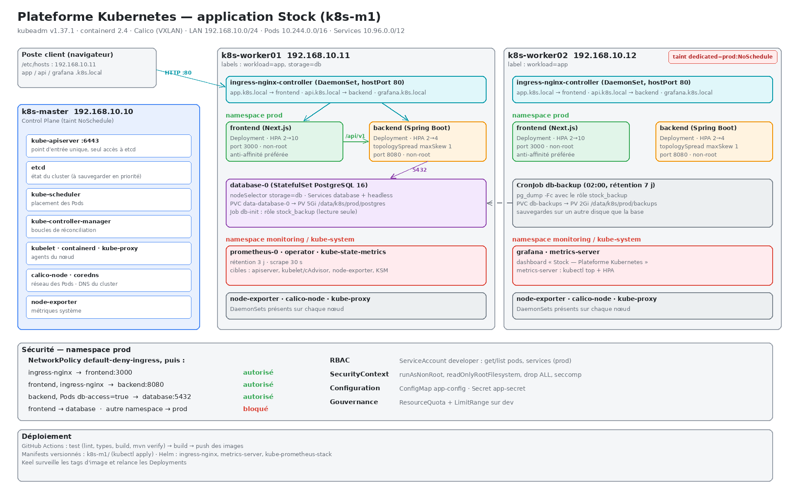

# k8s-m1 — Plateforme Kubernetes de l'application Stock

TP Kubernetes M1 DevOps / Cloud. Cluster kubeadm de 3 VMs qui héberge l'application **Stock** :

- frontend Next.js ;
- backend Spring Boot ;
- base PostgreSQL 16.



| Nœud | IP | Rôle |
|---|---|---|
| k8s-master | 192.168.10.10 | Control Plane (taint NoSchedule) |
| k8s-worker01 | 192.168.10.11 | Worker, `workload=app`, `storage=db` (porte la base) |
| k8s-worker02 | 192.168.10.12 | Worker, `workload=app`, taint `dedicated=prod:NoSchedule` (réservé à prod, porte les sauvegardes) |

Versions et réseaux :

- **Logiciels** : Kubernetes v1.37.1, containerd 2.4, Calico en VXLAN.
- **Réseau des Pods** : 10.244.0.0/16.
- **Réseau des Services** : 10.96.0.0/12.

## Arborescence

| Dossier | Contenu |
|---|---|
| `namespaces/` | dev, test, prod ; ResourceQuota et LimitRange de dev |
| `storage/` | StorageClass `local-storage`, PV de la base et des sauvegardes, démo de persistance |
| `statefulset/` | PostgreSQL : StatefulSet, Service headless et Service ClusterIP `database` |
| `configmaps/`, `secrets/` | `app-config` (APP_ENV, APP_NAME, LOG_LEVEL, API_URL…), `app-secret` (DB_USER, DB_PASSWORD, API_TOKEN) |
| `deployments/`, `services/` | frontend et backend : probes, resources, SecurityContext, affinités |
| `ingress/` | values Helm d'ingress-nginx ; Ingress app/api.k8s.local |
| `hpa/` | HPA frontend (2→10) et backend (2→4) ; générateur de charge |
| `scheduling/` | labels et taint des nœuds (`nodes.sh`) ; démo du taint |
| `jobs/`, `cronjobs/` | Job `db-init` (rôle de sauvegarde en lecture seule) ; CronJob `db-backup` (pg_dump quotidien) |
| `rbac/` | ServiceAccount `developer` en lecture seule ; procédure de test |
| `network-policies/` | default-deny puis flux autorisés ; `test-flux.sh` (test avant/après) |
| `monitoring/` | values de metrics-server et de kube-prometheus-stack ; dashboard Grafana |
| `helm/application/` | **chart Helm de l'application** : c'est lui qui déploie l'appli en prod (voir ci-dessous) |
| `helm/adopter.sh` | reprise par Helm des objets créés avant avec `kubectl apply` |
| `cicd/` | pipeline test → build → push (ghcr.io privé) → deploy (Helm, runner sur k8s-master) : [`cicd/README.md`](cicd/README.md) |
| `documentation/` | `installation.md`, `exploitation.md`, `incident-report.md`, script d'installation des nœuds |

## Déploiement complet (cluster déjà installé)

Toutes les commandes se lancent depuis `k8s-m1/`, sur le master. L'ordre compte.

```bash
# 1. Nœuds : labels et taint
./scheduling/nodes.sh

# 2. Briques de plateforme (Helm)
helm repo add ingress-nginx https://kubernetes.github.io/ingress-nginx
helm repo add metrics-server https://kubernetes-sigs.github.io/metrics-server/
helm repo add prometheus-community https://prometheus-community.github.io/helm-charts
helm repo update
helm upgrade --install ingress-nginx ingress-nginx/ingress-nginx --version 4.15.1 \
  -n ingress-nginx --create-namespace -f ingress/ingress-nginx-values.yml --wait
helm upgrade --install metrics-server metrics-server/metrics-server --version 3.14.0 \
  -n kube-system -f monitoring/metrics-server-values.yml --wait
helm upgrade --install monitoring prometheus-community/kube-prometheus-stack --version 92.21.2 \
  -n monitoring --create-namespace -f monitoring/kube-prometheus-stack-values.yml --wait --timeout 10m
kubectl apply -f monitoring/dashboard-stock.yml

# 3. Namespaces et stockage (liés aux nœuds, hors du chart)
kubectl apply -f namespaces/
kubectl apply -f storage/storageclass.yml -f storage/pv-postgres.yml -f storage/pv-backups.yml

# 4. Application complète (base, backend, frontend, Ingress, HPA, NetworkPolicy, sauvegarde, RBAC)
helm install application ./helm/application -n prod --wait --timeout 10m
helm test application -n prod
```

L'application est gérée par **Helm**. Les dossiers `statefulset/`, `deployments/`, `services/`, `ingress/ingress.yml`, `hpa/`, `jobs/`, `cronjobs/`, `rbac/` et `network-policies/` contiennent les mêmes objets en YAML brut, une étape du TP par dossier. Ils servent de référence et aux démonstrations, mais **ne pas les appliquer** sur une release Helm : Helm et kubectl se disputeraient les objets.

### Cycle de vie avec Helm

```bash
helm upgrade application ./helm/application -n prod --set config.logLevel=DEBUG   # nouvelle révision
helm upgrade application ./helm/application -n prod --set backend.image.tag=v1.3.0
helm history application -n prod
helm rollback application <révision> -n prod
helm get values application -n prod          # valeurs surchargées de la révision courante
```

Un `helm upgrade` sans `--set` ni `-f` réutilise les valeurs de la révision précédente. Pour revenir aux valeurs par défaut du chart, ajouter `--reset-values`.

Reprendre une application déjà installée avec `kubectl apply` :

```bash
./helm/adopter.sh application prod
helm install application ./helm/application -n prod --server-side=false
```

Le script explique pourquoi `--server-side=false` est nécessaire (voir aussi l'incident n°7).

Sur le poste client, ajouter dans `/etc/hosts` :

```
192.168.10.11  app.k8s.local api.k8s.local grafana.k8s.local
```

## Vérification rapide

```bash
kubectl get nodes -o wide
kubectl -n prod get pods,svc,ingress,hpa -o wide
curl -H 'Host: app.k8s.local' http://192.168.10.11/login           # 200
curl -H 'Host: api.k8s.local' http://192.168.10.11/actuator/health  # {"status":"UP"}
./network-policies/test-flux.sh                                     # tous les flux "ok"
```

Pour aller plus loin :

- **Exploitation courante** (sauvegarde, restauration, mise à jour, diagnostic) : [`documentation/exploitation.md`](documentation/exploitation.md).
- **Incidents rencontrés** : [`documentation/incident-report.md`](documentation/incident-report.md).

## Choix techniques principaux

- **Stockage** : hostPath épinglé par `nodeAffinity`, parce qu'un cluster kubeadm nu n'a pas de provisionneur dynamique. Les sauvegardes sont sur un autre nœud que la base. Limite assumée : la base dépend de worker01. En production, on utiliserait NFS, Longhorn ou Ceph.
- **Probes** :
  - startupProbe longue : Spring démarre en 60 à 110 s ;
  - readinessProbe sur `/actuator/health`, qui vérifie aussi la base ;
  - livenessProbe en simple test TCP, volontairement indépendante de la base.
- **Répartition** :
  - backend : `topologySpreadConstraints` avec `maxSkew: 1` et `matchLabelKeys: [pod-template-hash]` ;
  - frontend : anti-affinité préférée, compatible avec l'HPA à 10 replicas.
- **Sécurité** :
  - Pods non-root, système de fichiers racine en lecture seule, capabilities retirées ;
  - NetworkPolicy en default-deny ;
  - RBAC en lecture seule pour `developer` ;
  - clé JWT générée et stockée dans un Secret.
- **Secrets versionnés** : acceptable pour un laboratoire uniquement. En vrai projet : Sealed Secrets, SOPS ou External Secrets, et chiffrement d'etcd.
